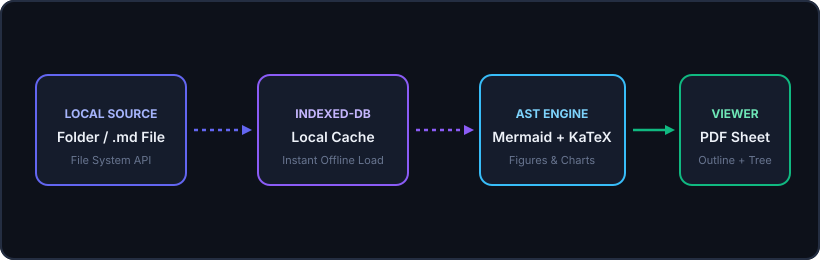
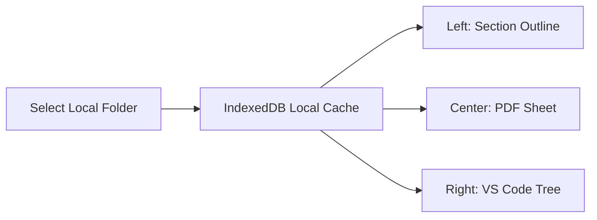

# Sample Documentation Folder (`sample-docs`)

Welcome to the on-disk **`sample-docs`** folder! You can select this folder using **Open Local Folder** to test directory tree navigation, local caching, figures, graphs, and cross-file Markdown links.

## Linked Markdown Files in This Folder

- **[Figures, Mermaid Diagrams & Charts](./guides/figures-and-graphs.md)**
- **[Mathematics, Equations & Tables](./guides/math-and-tables.md)**
- **[Architecture Overview](./architecture/overview.md)**

---

## Architecture Figure



---

## Live Mermaid Flowchart



---

## Code Highlighting & Contrast Check

Add the Header component JSX:

```js
function Header() {
  return (
    <header>
      <h2>App Header</h2>
    </header>
  );
}
```

Now add the header to the main App component:

```js
function App() {
  return (
    <div>
      <Header />
      <h1>Hello, React</h1>
    </div>
  );
}
```

