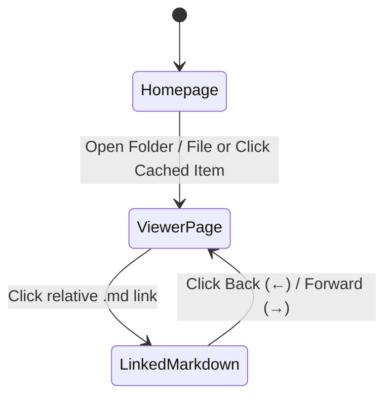

# Architecture Overview

← Back to **[Sample Docs Root](../README.md)** | Previous: **[Mathematics & Tables](../guides/math-and-tables.md)**

## Three-Column PDF-Viewer Workspace

1. **Left Sidebar (Sectional Navigator)**:
   - Displays all document headings (`H1`–`H6`) with scroll-spy tracking.
   - Includes a **FIGURES** tab listing all figures, Mermaid diagrams, charts, and tables.
2. **Center Canvas (PDF Document Sheet)**:
   - Dark-mode document page with zoom controls (`50%`–`200%`), page width toggle, typography switcher, in-page find (`Ctrl+F`), and Back/Forward history navigation.
3. **Right Sidebar (VS Code File Explorer)**:
   - Expandable/collapsible folder tree with search filter and quick cached workspace switching.

