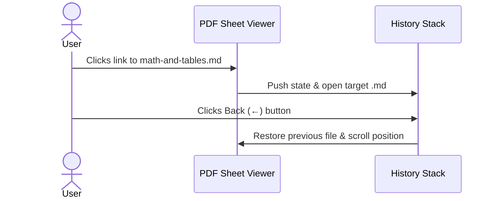

# Figures, Mermaid Diagrams & Interactive Graphs

← Back to **[README.md](../README.md)** | Next: **[Mathematics & Tables](./math-and-tables.md)**

## 1. Local Relative Figure with Caption


## 2. Sequence Diagram



## 3. Interactive Chart Block

```chart
{
  "type": "bar",
  "title": "Cache vs Disk Read Latency (ms)",
  "caption": "Locally cached folders open nearly instantaneously.",
  "labels": ["Cold Folder Read", "Cached Folder Open", "Cross-File Link"],
  "datasets": [
    {
      "label": "Latency (ms)",
      "data": [145, 5, 2],
      "backgroundColor": ["rgba(99, 102, 241, 0.7)", "rgba(16, 185, 129, 0.7)", "rgba(56, 189, 248, 0.7)"],
      "borderColor": ["#818cf8", "#34d399", "#38bdf8"]
    }
  ]
}
```
